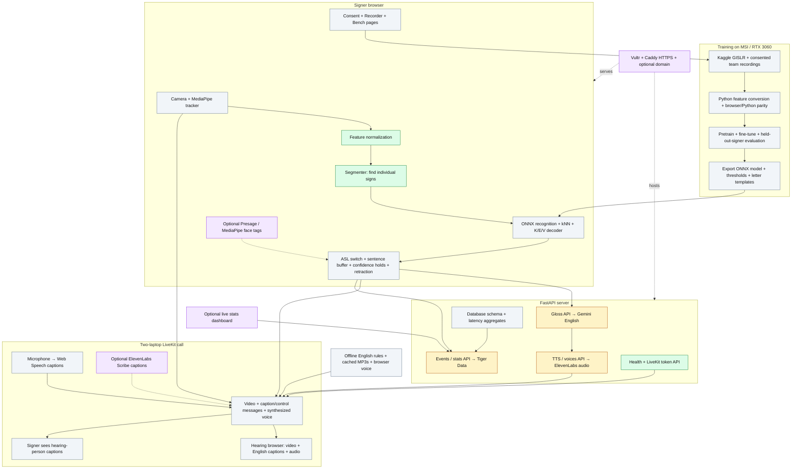

# SignLine: scope and implementation status

Status reviewed October 17, 2026 against `plan.md` v2 and the repository at
`48076b6`, including the latest segmenter commit. This is an implementation
inventory, not a claim that the complete app works.

## What we are building

A two-person video call where Kev signs a limited vocabulary, the other person
hears English speech, and that person's speech appears as captions for Kev.
The intended MVP recognizes 20 isolated signs plus K/E/V fingerspelling. It targets
roughly two seconds from a completed utterance to voice; latency and recognition
accuracy have not been measured yet.

The signer controls an ASL → voice switch. Confident sentences can speak
automatically; uncertain ones wait for confirmation. A “That was wrong” action
retracts a bad sentence. The app does not recognize continuous/fluent signing or
replace an interpreter. Mobile, multiparty calls, and medical/legal use are out
of scope.

## System drawing

Green = implemented component; amber = API code exists but live integration is
unverified; gray = planned; purple = stretch feature. Arrows show the intended
connections, not an already working end-to-end flow.

## What exists and what remains

| Area | Implemented / verified here | Still needed |
| --- | --- | --- |
| Development setup | React/TypeScript/Vite, Python environment, locked dependencies, three downloaded MediaPipe bundles, local browser runtimes, Git workflow | Keep environment snapshot/config current |
| Shared browser contracts | Types exist | Align with plan v2: ASL switch/control messages and caption retraction |
| Vocabulary | Original scaffold labels exist | Replace with shared `vocab.json`: 20 signs, idle, K/E/V; verify sign forms |
| Landmark processing | Feature normalization and temporal resampling; motion segmenter | Real camera tracker, browser benchmark, live tuning |
| Training/data | No `ml/` implementation or trained model in this checkout | Kaggle preparation, Recorder, consented clips, Python feature twin, parity tests, pretraining/fine-tuning, evaluation, ONNX export |
| Recognition | Feature and segmenter tests pass | Classifier decisions, ONNX loader, kNN fallback, letter decoder, complete signer pipeline |
| Backend API | Health, signed LiveKit tokens, gloss, TTS, voices, Scribe token, events, stats routes; six API tests | Actual Gemini/TTS/LiveKit service checks, DB schema and real DB queries |
| Credentials | Ignored server `.env` installed; setting presence verified | Provider authorization/connectivity checks; presence alone is not validation |
| Video call/UI | Development landing page | API client, LiveKit join/publish, call screen, captions, connection/error state |
| Voice and captions | Server endpoints exist | Audio publishing, Web Speech, confidence holds, ASL switch, retraction, consent UI |
| Failure recovery | Not implemented | Offline rules, cached audio, browser voice, reconnect/error handling |
| Deployment/stats | API code for logging/stats exists | Schema, measured events, dashboard, Vultr service/Caddy config and HTTPS verification |
| Demo/submission | Detailed plan exists | Two-laptop rehearsals, measured accuracy/latency, backup video, slides, Devpost |

## Phase map

| Phase | Goal | Current status |
| --- | --- | --- |
| 0 — Setup | Tools, accounts, local assets, team preparation | Development scaffolds/assets ready; local-machine GPU/data and team preparation unverified |
| 1 — Foundations | Call skeleton, tracker, features, segmenter, Recorder, backend, schema, data conversion | Partial: types, features, segmenter, API task 1.C1 implemented |
| 2 — Recognize and speak | Train/export model, recognize signs/letters, output voice, ASL switch, speech captions, offline fallbacks | Not implemented |
| 3 — Golden path | Wire recognition into the call and complete the demo on two laptops | Not implemented |
| 4 — Harden / sponsor depth | Deployment, stats, face tags, Scribe, calibration, failure drills | Not implemented; prioritize only after core demo works |
| 5 — Submit | Freeze, rehearse, backup video, slides, public repo/video, Devpost | Pending; plan deadline Sunday October 18 at 5 p.m. Eastern |
| 6 — After event | Technical write-up and key rotation | Pending |

Plan v2 schedules skeleton deployment/schema work early even though final
hosting/stats are described as stretch depth. The core workflow can be developed
locally; logging and deployment remain sponsor priorities.

## Next implementation order

The three tracks can advance independently with separate file ownership:

1. Backend: Task 1.C2 Gemini prompt test/evaluation, then 1.C3 real TTS check and
   1.C5 schema/database verification. Arrange 1.C4 deployment with the VM owner.
2. Call/UI: Task 1.A1 API client, LiveKit connection, captions and routing.
3. Recognition/data: align scaffold contracts/vocabulary with v2, then tracker +
   Bench (1.B1), Recorder (1.B4), Python feature parity (1.B5), Kaggle conversion
   (1.B6), and consented recording sessions. Features (1.B2) and segmenter (1.B3)
   are already implemented.
4. Train/evaluate and export the model while finishing the call UI, voice,
   recognition decisions, letters, and offline recovery.
5. Connect everything and prove the full demo on two laptops before adding stretch work.

The main unfinished dependency chains are camera → data → trained model → live
recognition, and call connection → audio/captions → safe sentence playback.
No end-to-end checkpoint has been demonstrated yet.

## Evidence from this review

- Frontend: **26 tests passed** across feature and segmenter suites.
- Backend: **6 tests passed** (one dependency deprecation warning).
- Production frontend build: **passed**.
- Earlier live local checks: health returned 200; locally signed LiveKit JWT
  signature/issuer/room grants verified without exposing tokens.
- Real LiveKit calls, Gemini output quality, ElevenLabs playback, Tiger Data
  connectivity/schema, GPU training, cameras and two-laptop workflow: **unverified**.
- The full-suite claims in `plan.md` describe the plan author's scratch-copy
  verification; they are not evidence those components exist in this checkout.
